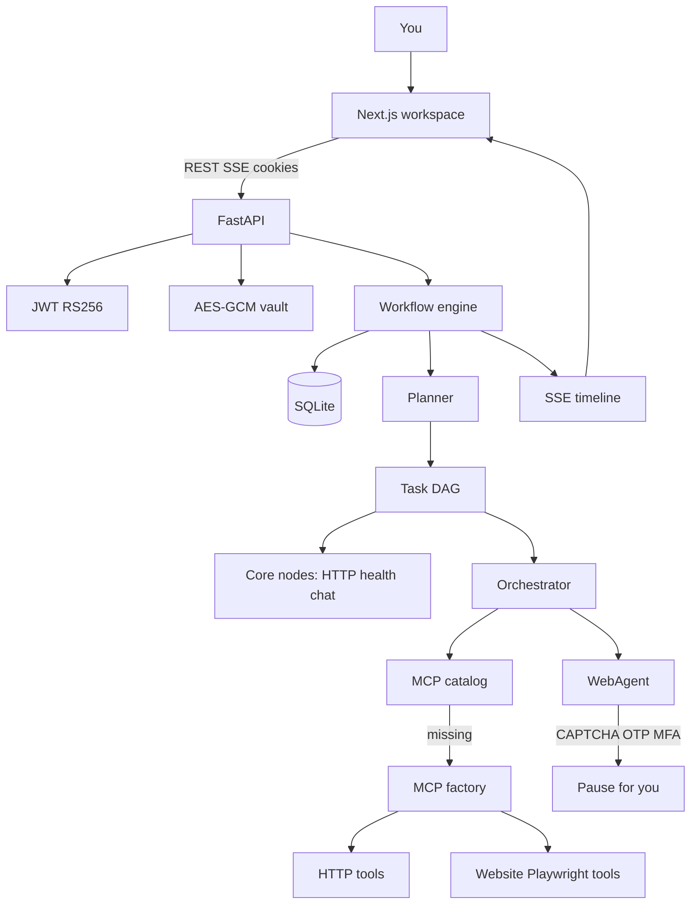
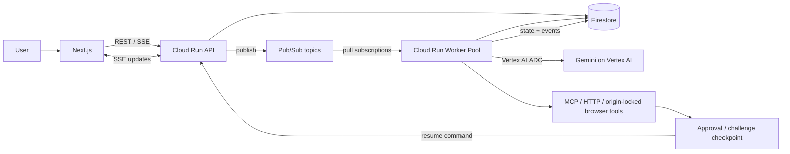
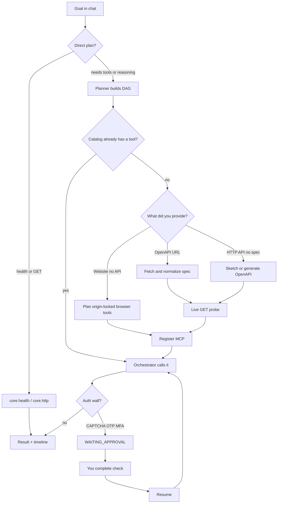
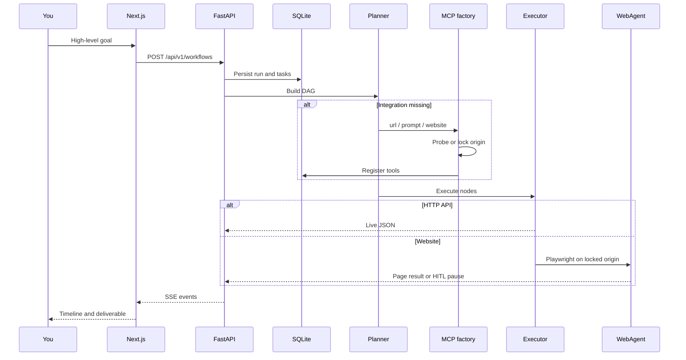

> **Deploy Sandtable:** Follow the [Google Cloud + Vertex AI deployment guide](docs/deploy-gcp.md). It covers a non-upgraded $300 trial, API, pull worker, frontend, secrets, and live verification. [Current readiness and remaining gates](docs/production-readiness.md).

# AgentOS

**Tell it what you want. It builds the tools and does the work.**

AgentOS is an autonomous AI workspace. You describe an outcome in plain language. A planner turns that into a DAG of tasks. If the tools needed to finish the work do not exist yet, the MCP factory **builds them**, probes them live, registers them, and the orchestrator continues in the same run.

It is not a chatbot with canned replies. Runs hit live HTTP APIs, a real browser, site health checks, an encrypted vault, resume generation, and an action timeline of what the agents actually did.

**Stack:** Next.js (port 3000) · FastAPI (port 8000) · SQLite locally · Firestore on Cloud Run · Gemini (AI Studio key locally, or Vertex on GCP).

**Readiness — 31 October 2026:** committed baseline v5.5.0 is under review.
Local tests do not establish production certification. Membership, spending,
browser, connector-evidence, and recovery gates remain; newer working-tree fixes
need regression verification. Registration does not make every tool executable.

Use the [22-phase full-stack roadmap](docs/full-stack-roadmap.md) for implementation
steps, existing/proposed file paths, dependencies, acceptance tests, and rollout.
[Current status](docs/implementation-status.md) separates present code from planned
work; [release evidence](docs/RELEASE_EVIDENCE.md) records verification boundaries.

## Local and cloud

The same codebase runs in both places. One setting switches storage; Gemini follows the key.

| | Laptop | Google Cloud |
| --- | --- | --- |
| How | `python main.py` + `npm run dev` | Cloud Run (`docs/deploy-gcp.md`) |
| Storage | `STORAGE_BACKEND=sqlite` | `STORAGE_BACKEND=firestore` |
| Gemini | `GEMINI_API_KEY` (AI Studio) | Leave the key empty; Vertex uses `GOOGLE_CLOUD_PROJECT` + the Cloud Run service account |
| Optional provider | `LLM_PROVIDER=groq`, `GROQ_API_KEY`, `GROQ_MODEL` (Groq); `LLM_PROVIDER=huggingface`, `HF_TOKEN`, `HF_MODEL` (HF Inference Providers); or `XAI_API_KEY` + `GROK_MODEL` for shared-call fallback | Store the selected provider key in Secret Manager if enabled |
| Secrets | `.env` (gitignored) | Secret Manager |
| Data | `data/agentos.db` | Firestore (survives scale-to-zero) |

Repository: [umangvijay/AgentOS-an-Automation-tool](https://github.com/umangvijay/AgentOS-an-Automation-tool)

### Phase 20 local-first infrastructure

- **Doctor**: `python scripts/local_doctor.py` verifies every local prerequisite and names the fix for each gap (`--json` for tooling).
- **Compose profiles**: `compose.yaml` (9 services, 6 opt-in profiles — core, browser, runner, local-ai, emulators, observability) with healthchecks and named volumes; start/stop/restart preserves state.
- **PostgreSQL + JetStream**: the §20.4/§20.5 contract suites run against real Postgres 16 and NATS (`docker compose --profile core up`).
- **Artifact store** (§20.6): immutable revision identities, per-file digests, authorized downloads ([docs/local-production.md](docs/local-production.md)).
- **Provider adapters** (§20.7–§20.9): Gemini/Vertex/Bedrock/Ollama behind one interface with per-user config isolation ([docs/provider-authentication.md](docs/provider-authentication.md)).
- **Isolated runner** (§20.14): credential-free, resource-limited subprocess jail ([docs/local-runner.md](docs/local-runner.md)).
- **Browser execution + viewer/takeover** (§20.15–§20.16): real Playwright sessions with server-enforced ownership ([docs/browser-viewer.md](docs/browser-viewer.md)).
- **Learning pipeline** (§20.21–§20.23): classified self-healing, genuine PPO training with held-out evaluation, controlled self-evolution ([docs/learning-pipeline.md](docs/learning-pipeline.md)).
- **Telemetry correlation** (§20.25): run/task/agent/invocation/effect/browser/artifact/recovery/policy ids ride every span and log line.
- **Cloud portability** (§20.27): helm chart + storage/bus/inference swap matrix ([docs/cloud-portability.md](docs/cloud-portability.md)); phase gate evidence in [docs/evidence/phase-20.md](docs/evidence/phase-20.md).

## Features

- **Dynamic MCP factory** — candidate tools from OpenAPI, API descriptions, or supported website workflows. Inferred operations require evidence; arbitrary apps are not guaranteed to work. Declarative adapters are the primary product; isolated generated-server execution has separate release gates.
- **Chat-first automation** — workspace chat plans, builds missing integrations mid-run, then calls the new tools. Follow-up messages reuse the catalog.
- **Orchestrator + DAG engine** — planner *is* the decomposer. Core nodes (HTTP, health, chat) run without a model.
- **Recovery foundation** — bounded retries, plan/input repair, leases, and uncertain-outcome quarantine. Provider reconciliation and deployed failure behavior need acceptance evidence. Supported authentication challenges pause for human intervention.
- **Adaptive routing foundation** — UCB-style ranking and epsilon exploration reorder model candidates. Current execution-success signals need outcome verification before claiming improved task quality. This does not train model weights; see roadmap phases 12–14.
- **Shared catalog** — publish verified integrations to `/dashboard/catalog`; installs clone the integration per user, never the publisher's credentials.
- **API keys** — `vry_…` programmatic credentials for MCP clients and CI (hash-stored, shown once, individually revocable).
- **Budget enforcement (Phase 2)** — every paid provider call holds a durable, individually identified reservation admitted atomically across all applicable limits; settlement is idempotent, overruns are recorded in full, uncertain outcomes keep their hold pending reconciliation, and the UI shows the authoritative accounting equation (`/usage/budget`) separate from context estimates. Spec: [docs/budget-accounting.md](docs/budget-accounting.md).
- **Admission & capacity control (Phase 3)** — cross-replica shared rate limiting with epoch-accurate windows, typed admission decisions (429 quota vs 503 outage, per-workload fail-open/fail-closed), durable capacity leases with fencing and TTL recovery, bounded durable command queues with tenant pending caps, atomic schedule occurrence claims, provider backoff with jitter and Retry-After, precise frontend overload states, and an admin enforcement-metrics surface. Spec: [docs/admission-and-capacity.md](docs/admission-and-capacity.md).
- **Durable command lifecycle (Phase 4)** — every accepted instruction is a durable command with a conditional, version-guarded lifecycle; acceptance commits command + queue accounting + initial work + outbox event atomically; publication is crash-recoverable; cancellation is a truthful protocol; a bounded reconciler self-heals expired deadlines, lost dispatches, and stranded parent waits. Spec: [docs/command-lifecycle.md](docs/command-lifecycle.md).
- **External effects & reconciliation (Phase 5)** — every consequential external action (email first) is recorded as a durable effect with canonical identity; server acceptance is distinguished from delivery; partial outcomes keep per-recipient truth; unknown outcomes pause automatic resend and are resolved only by operation-specific evidence. Spec: [docs/external-effects.md](docs/external-effects.md).
- **Connector validation & revisions (Phase 6)** — operation-level eligibility from one authoritative evaluator; provenance never upgrades by being tested; revision identity is canonical and immutable; credential-context rotation supersedes evidence; activation is atomic with racing-conflict detection; restored copies never inherit execution authority. Spec: [docs/connector-validation.md](docs/connector-validation.md).
- **Standalone MCP servers (Phase 7)** — portable source export clearly marked untested; trusted, HMAC-signed validation attestations bound to exact artifact digests; deployment eligibility re-checked from current records (content change, isolation profile, op-level eligibility, revocation); managed isolated execution contract in place with the runner backend gated pending isolation proof. Spec: [docs/standalone-mcp.md](docs/standalone-mcp.md).
- **Browser runtime, ownership & recovery (Phase 8)** — durable session metadata with separate lifecycle/controller/challenge dimensions; epoch-fenced ownership (racing workers resolve to one); network policy separating navigation from resource traffic; credential injection bound to origin and field purpose; material action-intent approvals; browser effects through the Phase 5 ledger (crash → reconcile, never resend); short-lived takeover grants. Spec: [docs/browser-runtime.md](docs/browser-runtime.md).
- **DOM targeting & verified actions (Phase 9)** — semantic target resolution (role+name+business identity, never positional); staleness rules per change dimension; the action pipeline enforcing ownership, policy, approval digests, and effect recording; outcome verification separating interaction from business evidence; bounded progress tracking. Spec: [docs/dom-targeting.md](docs/dom-targeting.md).
- **Verified ReAct orchestration (Phase 10)** — structured observation→action→policy→result→verification records with evidence digests; bounded loops (iterations/wall-time/spend/tool-calls/repeats enforced outside the model); outcome-gated completion (model done requests verification, never self-establishes success); uncertain effects block completion until reconciled. Spec: [docs/verified-react.md](docs/verified-react.md).
- **Recovery episodes (Phase 11)** — durable recovery episodes with atomic ownership claims, epoch fencing, explicit state machines, persistent limits, cycle detection, and verified-recovery outcomes. Spec: [docs/recovery-episodes.md](docs/recovery-episodes.md).
- **Security and operations foundation** — logout revocation, signed run webhooks, retention routines, audit records, and request limits. Shared limits and broader enterprise controls remain roadmap work.
- **Human-in-the-loop** — AgentOS never fills CAPTCHA, SMS OTP, or MFA. Complete the check, then Resume.
- **Vault** — AES-256-GCM credentials. After save, the API returns names only.
- **ATS resume** — scan against a job description, tailor from notes, HTML preview and download.
- **Studio** — site health, debug (code is not executed), generate a downloadable site or app.
- **Action timeline** — SSE events from the live run, not a fake progress bar.
- **Guest workspace** — try the product without creating an account first.

### MCP from chat

| You have | You type | What gets built |
| --- | --- | --- |
| OpenAPI URL | `Create MCP tools from https://…/openapi.json then list …` | HTTP tools from the spec, live-probed, then called |
| HTTP API, no spec | `Build MCP tools for [app] so I can [list / get / create …]` | HTTP tools on the public host (GitHub, Open-Meteo, PokeAPI, …) |
| Website, no API | Vault login, then `Create MCP tools for https://…`, then `Log in with vault credential NAME and use runOnSite …` | Browser tools (`runOnSite`, `login`, …) locked to that origin |

Same three paths exist on **Integrations → Create**.

The examples and diagrams describe intended workflows. Execution requires
operation-specific evidence, credentials, policy approval, and supported runtime
behavior. A passing probe covers its operation, not an entire integration;
inferred APIs and browser workflows need their own validation. Registration
alone does not prove restart-safe execution or standalone-server support.

## Architecture

Next.js is the workspace UI. FastAPI owns auth, the vault, the MCP registry, and the workflow engine. The engine plans a DAG, the MCP factory fills gaps, and Playwright runs only on a locked origin.



### Cloud runtime and durable event flow

The cloud topology is different from the local in-process worker. Cloud Run
serves HTTP requests; a separate long-running Cloud Run Worker Pool pulls from
Pub/Sub. Both processes must use Firestore and the same project configuration.
The API and worker use separate service identities and least-privilege IAM.



The event path is at-least-once: handlers must be idempotent, and persistent
failures need bounded retries and dead-letter handling. This diagram describes
the intended GCP deployment; it is **not evidence that a live GCP project has
been deployed or verified**. See [production readiness](docs/production-readiness.md)
and [GCP deployment](docs/deploy-gcp.md).

## Flowchart

What happens after you send a goal.



## Data flow



Local stores: `data/agentos.db` (users, runs, tasks, MCP registry), vault ciphertext in SQLite, JWT keys under `backend/security/keys/` (gitignored). Optional cloud persistence is Firestore — see [docs/architecture.md](docs/architecture.md).

## Quick start

```bash
cd AgentOS
python3 -m venv .venv && source .venv/bin/activate
pip install -r requirements.txt
playwright install chromium
cp .env.example .env   # set GEMINI_API_KEY
.venv/bin/python main.py
cd frontend && npm install && npm run dev
```

- App: http://localhost:3000
- API: http://127.0.0.1:8000
- In-app docs: http://localhost:3000/docs

Set `LLM_PROVIDER=groq` and `GROQ_API_KEY` or `LLM_PROVIDER=huggingface` and `HF_TOKEN` to use those OpenAI-compatible providers for shared model calls and ADK planner/orchestrator tasks. Hugging Face routes through `https://router.huggingface.co/v1`; use a hosted model ID such as `openai/gpt-oss-120b` in `HF_MODEL` (no model upload to this code repository is needed). For Gemini use `LLM_PROVIDER=gemini` with `GEMINI_API_KEY`; for GCP Vertex use `LLM_PROVIDER=vertex` and the configured project/service account. In `auto` mode Gemini takes precedence, then Vertex, Groq, and Hugging Face. Do not commit local environment files. Cloud Run + Vertex + the $100 kill switch: [docs/deploy-gcp.md](docs/deploy-gcp.md).

## Docs

- [Budget & usage accounting spec (Phase 2)](docs/budget-accounting.md)
- [Admission & capacity spec (Phase 3)](docs/admission-and-capacity.md)
- [Command lifecycle spec (Phase 4)](docs/command-lifecycle.md)
- [External effects spec (Phase 5)](docs/external-effects.md)
- [Connector validation spec (Phase 6)](docs/connector-validation.md)
- [Standalone MCP spec (Phase 7)](docs/standalone-mcp.md)
- [Browser runtime spec (Phase 8)](docs/browser-runtime.md)
- [DOM targeting spec (Phase 9)](docs/dom-targeting.md)
- [Verified ReAct spec (Phase 10)](docs/verified-react.md)
- [Recovery episodes spec (Phase 11)](docs/recovery-episodes.md)
- [Detailed full-stack roadmap: phases 00–21](docs/full-stack-roadmap.md)
- [Phase index and execution order](docs/PHASES.md)
- [Current implementation status](docs/implementation-status.md)
- [Release evidence and reopened findings](docs/RELEASE_EVIDENCE.md)
- [Frontend development guide](frontend/README.md)
- [Architecture](docs/architecture.md)
- [MCP builder](docs/mcp-builder.md)
- [Automation](docs/automation.md)
- [User guide](docs/user-guide.md)
- [Local production (Phase 20)](docs/local-production.md)
- [Provider authentication](docs/provider-authentication.md)
- [Local runner](docs/local-runner.md)
- [Browser viewer and takeover](docs/browser-viewer.md)
- [Learning pipeline](docs/learning-pipeline.md)
- [Cloud portability](docs/cloud-portability.md)
- [Phase 20 evidence matrix](docs/evidence/phase-20.md)
- [Security](docs/SECURITY.md)
- [Production readiness and improvement plan](docs/production-readiness.md)
- [Environment setup](docs/environment-setup.md)
- [Google Cloud deploy](docs/deploy-gcp.md) — redeem credits, Vertex Gemini (no API key), Cloud Run, **$100 kill switch**
- [Diagrams](docs/diagrams/)

## Honest limits

- Advanced self-improvement, contextual routing, new specialized subagents, and
  optional 3D workflow exploration are planned extensions. Their roadmap entries
  do not imply shipped functionality.
- Website MCP is **UI automation**, not a hidden official API.
- CAPTCHA, SMS OTP, and bank MFA require you. AgentOS will not complete them for you.
- Paid APIs (for example live Stripe charges) need your own keys in the vault.
- Vertex AI, Firestore, Pub/Sub, and the cloud worker path require project
  credentials and IAM. Without them, those cloud features cannot be called
  live; local passing tests do not prove provider or cloud integration health.
- The current system is not yet enterprise production-ready. Review the
  verified controls, known gaps, and release gates in
  [docs/production-readiness.md](docs/production-readiness.md).
