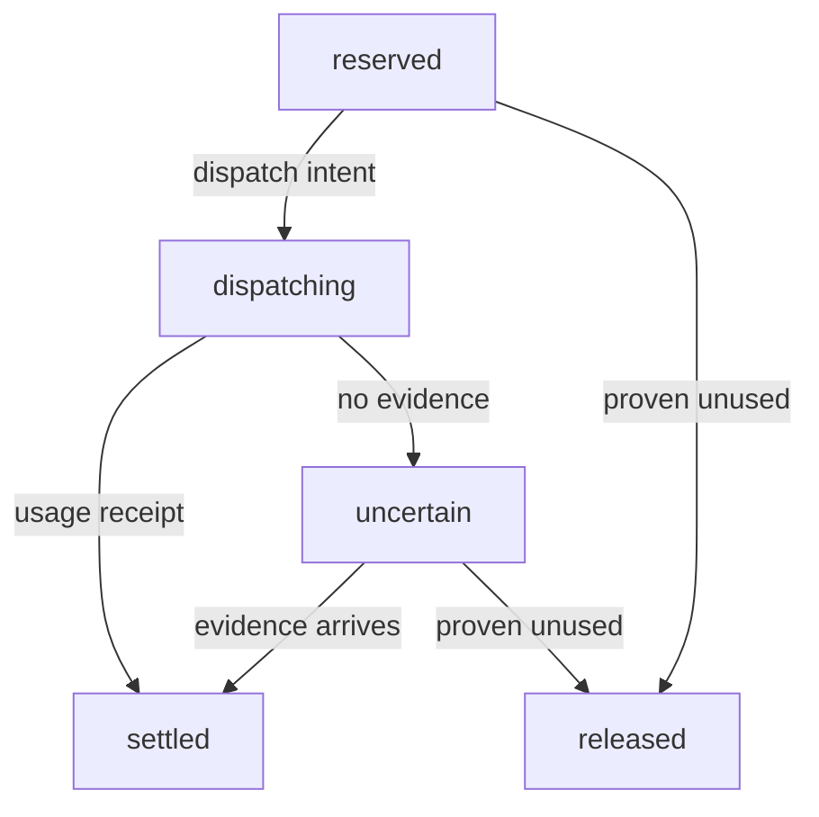

# Budget & Usage Accounting — Phase 2 Specification

Status: **implemented (Phase 2)** · Owner: platform · Applies to every paid provider call.

This document is the authoritative specification for AgentOS budget
enforcement and usage accounting: service behavior, database schema, API
contract, and frontend presentation. `docs/production-readiness.md` and
`docs/RELEASE_EVIDENCE.md` reference it; the frontend budget panel is built
against the snapshot defined here.

---

## 1. Guarantees (§2.1)

Phase 2 guarantees the following. Each is covered by tests named in §10.

| # | Guarantee |
|---|---|
| G1 | Every supported paid provider request obtains a **durable reservation** before dispatch. |
| G2 | Reservation admission is **atomic across all applicable limits** (fresh rows and existing rows enforce identical caps). |
| G3 | A repeated reservation request (same request key + same digest) returns the **same hold** — never a second hold. |
| G4 | A repeated settlement of the same reservation counts consumption **once**. |
| G5 | A failed or interrupted request is **not automatically free**: holds survive until proven unused or reconciled. |
| G6 | A worker restart **erases neither reservations nor settled usage** (both live in the durable store). |
| G7 | Missing or unavailable accounting **blocks new paid execution** (fail closed, HTTP 503 / `ACCOUNTING_UNAVAILABLE`). |
| G8 | The UI distinguishes **measured usage, estimates, active holds, and uncertainty**. |
| G9 | The actual provider request runs with limits consistent with its reservation (bounded output, metered retries). |
| G10 | Accounting corrections are **append-only and auditable**, tied to the original reservation. |

### Boundary of the guarantee

An application cannot promise an exact provider-invoice ceiling when the
provider's billable quantities are not bounded or reliably reported. The
enforceable contract is:

> AgentOS admits only calls covered by its reservation policy, applies
> supported request limits, records actual reported usage, and blocks further
> work when an overrun or accounting uncertainty requires intervention.

Recorded usage is **never silently truncated** to make the cap appear
respected. Overruns are recorded in full and surfaced (§6.4).

---

## 2. Concepts kept distinct (§2.2)

| Concept | What it measures | Source |
|---|---|---|
| Context estimate | How much material may occupy a model request | Request content + estimator (`~4 chars/token`) |
| Token consumption | Tokens consumed by provider calls | Provider usage metadata, with labeled fallback estimates |
| Reserved tokens | Allowance held for unfinished calls | Reservation records (`budget_reservations`) |
| Estimated cost | Usage × versioned pricing model | Normalized usage + `MODEL_COST_PER_1M_TOKENS` |
| Provider invoice | What the provider actually bills | Provider billing console (out of scope) |
| Infrastructure cost | Worker/DB/storage/browser spend | Cloud billing (out of scope) |

A large context estimate is **not** expenditure. `/usage/context` remains a
context-window estimator; `/usage/budget` is the authoritative spending
endpoint (§8). Monetary allowance enforcement is deferred until pricing and
billable-unit coverage are reliable; the token allowance is the enforced
budget unit (`unit="tokens"`).

---

## 3. Budget scopes and policy (§2.3)

| Scope | Purpose | Controlled by |
|---|---|---|
| `platform` | Ceiling the service permits | Platform administrator (settings/env) |
| `org` | Shared organization allowance | Org owner/admin (`org_settings`-level daily limit) |
| `user` | Personal daily usage | User, bounded by platform ceiling |
| `run` | Max spend for one workflow run | Run creator (future; reserved in model) |
| `call` | Max size of one provider request | Execution policy (`MAX_OUTPUT_RESERVE_TOKENS` + estimator) |

A call must satisfy **every applicable constraint**: user allowance remaining
does not authorize execution when the org's shared allowance is exhausted.
Payer attribution: personal runs bill the user; org runs bill the org bucket;
guest and background maintenance bill the platform; scheduled runs bill their
saved owner's scope. Phase 2 enforces user and platform scopes durably (org
scope is enforced when an org run declares an `org_id`).

### Settings semantics

- `null` → inherit the configured default.
- `0` → no new paid usage.
- Negative values → rejected (`422`).
- Values above the platform ceiling → clamped to the platform ceiling; a user
  can never raise an administrator-controlled ceiling.
- Reducing a limit does not erase consumed usage or outstanding holds.
- Policy updates are versioned (`policy_version`) and audited.

---

## 4. The accounting equation (§2.4)

For every enforced bucket:

```text
Available = Limit − Settled consumption − Outstanding holds
```

Outstanding holds include reservations that are reserved, dispatching, or
uncertain. Uncertain reservations are counted **once** (they are part of
`reserved`, not an additional subtraction).

Worked example (daily limit 100,000):

```text
Settled consumption:   65,000
Outstanding holds:     20,000   (of which 5,000 uncertain)
Available allowance:   15,000
```

A request needing 18,000 is rejected **before dispatch** (`BUDGET_EXHAUSTED`,
`retryable_now=false`).

When a 10,000-token hold settles at 6,000 actual: consumption +6,000, holds
−10,000, available +4,000. When actual usage exceeds the hold: record the
actual amount in full, record an overrun incident, allow availability to go
negative, and block further paid work until an operator or the reset resolves
it. Overruns are never clipped.

---

## 5. Reservations (§2.5, §2.6)

### Identity

Every reservation is an individual durable record with a generated
`reservation_id` (UUID, generated **before** the transaction) and a unique
`request_key` for idempotent retrieval. Three identifiers stay distinct:

| Identifier | Meaning |
|---|---|
| `task_id` / `run_id` | The user-visible work |
| `call_id` | One intended model invocation within that task |
| `attempt_id` | One actual provider attempt |

Key discipline: same key + same `request_digest` → return the existing
reservation (replay); same key + different digest → `RESERVATION_CONFLICT`;
a genuine new attempt → new attempt identity and reservation.

### State machine



- **reserved** — hold committed; provider request not dispatched.
- **dispatching** — intent committed; a crash here may leave provider-side
  uncertainty. Transition is guarded by optimistic concurrency
  (`record_version`).
- **settled** — usage recorded and hold removed in one atomic transaction.
- **uncertain** — may have incurred usage; remains counted inside `reserved`
  until resolved.
- **released** — proven unused (e.g. validation failure before dispatch, or
  reconciliation established no charge).

Rules: a timeout is not proof of no usage; cancellation is not proof that
provider generation stopped; an expired lease is not proof that nothing
happened; expiry triggers **reconciliation, not unconditional release**;
replaying a settlement returns the prior result; conflicting settlements go
through the explicit correction path (§9).

---

## 6. Reservation lifecycle (§2.8, §2.10, §2.13)

### 6.1 Reserve (atomic)

1. Generate `reservation_id` outside the transaction.
2. Open an exclusively-owned write transaction (`BEGIN IMMEDIATE` on SQLite;
   `run_transaction` on Firestore).
3. Look up the reservation by `request_key` → identical replay returns the
   existing record; digest mismatch raises `RESERVATION_CONFLICT`.
4. Load applicable policy and budget buckets (user + platform).
5. Validate every allowance: `settled + held + requested ≤ limit` for **each**
   bucket, including the fresh-row case (the insert itself carries the guard).
6. Insert the reservation row, raise each bucket's `reserved` counter, append
   a `reservation_created` accounting event.
7. Commit. Any failure rolls back everything and **no provider call is made**.

Errors are typed: `BUDGET_EXHAUSTED` (insufficient allowance),
`ACCOUNTING_UNAVAILABLE` (store down — fail closed), `RESERVATION_CONFLICT`,
`BUDGET_POLICY_INVALID` (bad input), `RESERVATION_NOT_FOUND`.

### 6.2 Settle (atomic, idempotent)

1. Load the reservation by ID.
2. Already `settled` with the same receipt digest → return the original
   settlement (idempotent replay). Conflicting receipt → `SETTLEMENT_CONFLICT`
   correction path (§9).
3. Decrease each bucket's `reserved` by the original hold; increase
   `consumed` by the normalized actual usage (never clipped).
4. Store the receipt + `reservation_settled` event; state → `settled`.

### 6.3 Failure, cancellation, streaming

| Failure point | Accounting action |
|---|---|
| Validation fails before reservation | No reservation |
| Reservation transaction fails | Do not dispatch |
| Cancellation before dispatch proven | Release unused |
| Crash after dispatch intent | Hold preserved; reconciliation investigates |
| Provider timeout after transmission | Mark uncertain |
| Provider returns usage with an application error | Record the usage |
| JSON parsing fails after generation | Settle model usage; parsing failure handled separately |
| Stream disconnects before final usage | Uncertain, or documented reconciliation |
| DB fails after provider success | Hold retained; bounded recovery retries settlement |
| Same settlement event replayed | Prior result returned, no double count |
| Fallback provider attempted | New attempt, new reservation |
| Worker terminated during generation | Hold preserved |

Streaming: reserve before opening the stream; collect final usage metadata;
intermediate chunks are never authoritative usage; client disconnect ≠
provider cancellation; settle once.

### 6.4 Overrun

If actual usage exceeds the hold, the full actual is recorded (the bucket may
go negative), an `overrun` incident is logged, and the overspend blocks new
admission until the period resets or an operator corrects it.

---

## 7. Normalization (§2.12)

`backend/services/usage_normalizer.py` converts provider-specific usage
metadata into a common receipt. Fields: `provider`, `requested_model`,
`resolved_model`, `provider_request_id`, `input_tokens`, `output_tokens`,
`cached_input_tokens`, `reasoning_tokens`, `reported_total_tokens`,
`normalized_policy_units`, `measurement_source`
(`provider_reported` | `estimated` | `unknown`), `normalizer_version`,
`received_at`.

Rules: missing provider fields stay **unknown** (never false zeroes); cached
and reasoning tokens are not double-counted when the provider includes them
in totals; the provider's reported total is kept alongside the normalized
value; text-length estimation is an **estimate** (`measurement_source=
"estimated"`). The reservation estimator includes system instructions,
history, tool definitions/results, retrieved memory, multimodal inputs, and
the bounded output reserve — the 4-chars/token heuristic is an estimate, not
a hard-cap proof, so the reservation includes headroom and overruns are
survivable (§6.4).

---

## 8. API (§2.15)

### `GET /api/v1/usage/budget` — authoritative snapshot

```json
{
  "scope": "user",
  "unit": "tokens",
  "period_start": "2026-10-31T00:00:00Z",
  "period_end": "2026-11-01T00:00:00Z",
  "limit": 100000,
  "consumed": 65000,
  "reserved": 20000,
  "uncertain_reserved": 5000,
  "available": 15000,
  "accounting_status": "healthy",
  "policy_version": "budget-policy-3",
  "as_of": "2026-10-31T10:00:00Z"
}
```

`uncertain_reserved` is a **subset** of `reserved`, not an extra subtraction.
`accounting_status` ∈ `healthy | degraded | unavailable`. When accounting is
unavailable the endpoint returns an explicit unavailable state — never a
plausible zero.

### `POST /api/v1/usage/budget/check` — admission probe

Structured errors (HTTP mapping documented in the router):

| Code | HTTP | Meaning |
|---|---|---|
| `BUDGET_EXHAUSTED` | 402/429 | Insufficient allowance (`available`, `required`, `retryable_now` in body) |
| `ACCOUNTING_UNAVAILABLE` | 503 | Ledger down; paid work blocked |
| `RESERVATION_CONFLICT` | 409 | Key reuse with a different payload |
| `BUDGET_POLICY_INVALID` | 422 | Invalid request (negative/oversized units, unknown model) |
| `RESERVATION_NOT_FOUND` | 404 | Unknown reservation id |

Reservation and settlement operations are internal (service-to-service);
there is no public endpoint that mutates the ledger.

---

## 9. Corrections and reconciliation (§2.19)

Administrative correction requires: an authorized operator, a reason,
supporting evidence, an **append-only** `budget_adjustment` event correlated
to the original reservation, and idempotency (`correction_id`). Totals are
never edited in place without history. Reconciliation candidates (reservations
stuck in `dispatching`/`uncertain` past their expiry) are listed by the
repository and resolved through the same settled/released events as normal
traffic.

---

## 10. Implementation map

| Piece | Location |
|---|---|
| Domain model (scopes, states, errors, snapshots) | `backend/models/usage.py` |
| Repository contract | `backend/repositories/usage_repository.py` (`UsageRepository` protocol) |
| SQLite schema + atomic ops | `backend/repositories/sqlite/database.py` (`budget_reservations`, `budget_events`, `budget_buckets`), `SQLiteUsageRepository` |
| Firestore parity | `FirestoreUsageRepository` |
| Service + reconciliation | `backend/services/budget_service.py` |
| Usage normalization | `backend/services/usage_normalizer.py` |
| Metered execution boundary | `gemini_client.py` (`metered_generation`), `groq_adk.py`, `huggingface_adk.py`, `embedding_service.py`, `resume_tailor_service.py`, `jd_parser_service.py`, `web_agent.py` (via shared client) |
| Snapshot API | `backend/api/routers/usage.py` (`/usage/budget`) |
| Frontend | `frontend/src/components/BudgetUsagePanel.tsx`, `BudgetBlockedNotice.tsx`, `frontend/src/lib/api.ts` |
| Tests | `test_budget_defects.py`, `test_budget_reservations.py`, `test_budget_concurrency.py`, `test_budget_provider_coverage.py`, `test_budget_reconciliation.py`, `frontend/e2e/budget-controls.spec.ts` |

### Migration (§2.18)

Legacy `usage_ledger` daily aggregates are preserved as **legacy
consumption**: they remain the `consumed` seed for their (user, day) and are
labeled `legacy` in the accounting events. The old `_record_usage_estimate`
write path no longer adds durable usage for metered calls (exactly one
authoritative path records consumption — the reservation settle); it keeps
only the process-local cache and per-run accounting. The durable write path
is reserved for unmetered legacy callers and is idempotent per call identity.

### Mixed versions

Old workers that do not reserve must be drained before strict enforcement is
enabled; rollback must not silently remove budget protection. Enable strict
mode per scope (`BUDGET_ENFORCEMENT_MODE=observe|enforce`) and record the
mode in the snapshot's `policy_version`.

---

## 11. Acceptance (§2.17, §2.21)

Phase 2 is accepted when every guarantee in §1 is demonstrated by the tests
in §10 against both SQLite and Firestore, evidence is recorded in
`docs/RELEASE_EVIDENCE.md` for the exact tested revision, and the checklist
in the roadmap §2.21 has been verified. Known-defect regressions
(`test_budget_defects.py`) must stay green forever.
